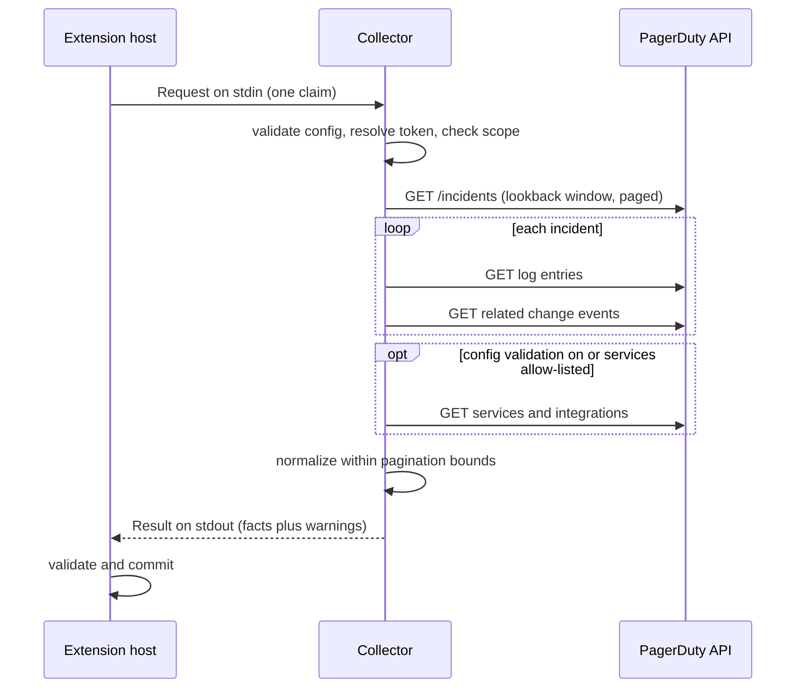

# Diagrams

Every diagram for eshu-collector-pagerduty lives on this page, each with a caption and a plain-text version. Other pages link here instead of repeating the picture. The root README keeps the first one only.

## Where this collector sits

Caption: the provider answers, this collector translates, the Eshu extension host validates and commits, and Eshu core stores what it admits.

Text version: provider API → this collector → Eshu extension host → Eshu core. The host drives the exchange one claim (one bounded unit of work) at a time; the collector never runs on its own schedule.

## The neighborhood, with responsibilities

Caption: the same chain with the host's claim edge made explicit. The host owns claims, leases, envelope building, validation, and commits; core owns admission, projection, and persistence.

Text version: the host hands over one claim and takes back one result. Everything between "host asked" and "here is what the provider said" belongs to this collector; everything downstream belongs to the host and core.

## One claim, start to finish

Caption: the sequence inside a single claim — config and credentials resolve before any network call, provider reads run in order within their bounds, and one result goes back on stdout.

Text version: request in on stdin → parse config, resolve env-named credentials, check grant/scope → pick the target for the claim scope → bounded provider GET reads → normalize and fingerprint → one result out on stdout → host validates and commits.
